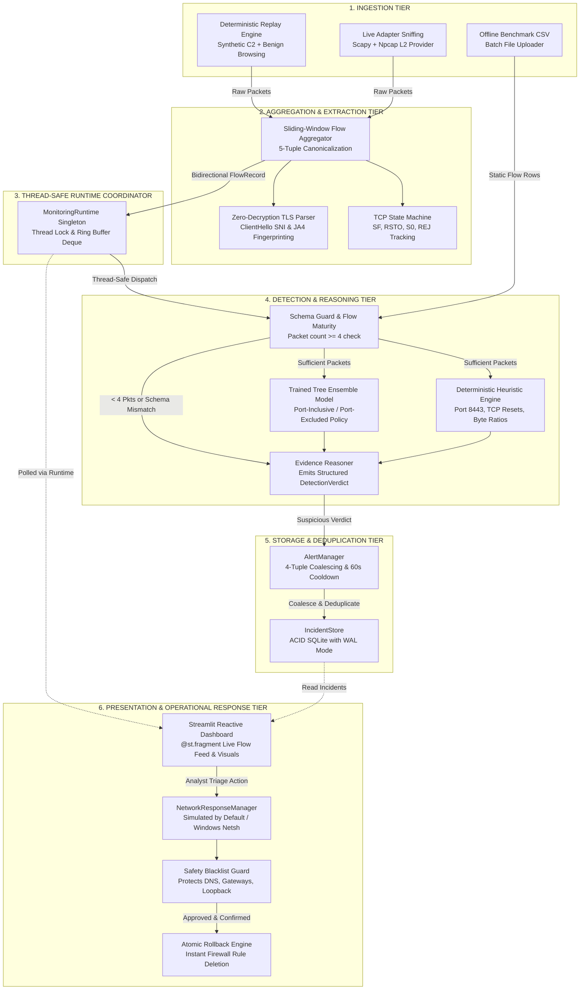

# XShield: Explainable AI-Assisted Encrypted Network Traffic Monitoring & Incident Response Prototype

[](https://www.python.org/)
[](https://streamlit.io/)
[](https://scikit-learn.org/)
[]()
[](LICENSE)
[]()

> **Transparent, privacy-preserving threat detection and analyst-governed containment for encrypted network flows using bidirectional traffic dynamics and unencrypted TLS handshake metadata—without decrypting application payloads.**

---

## 1. Project Overview

Over 85% of modern enterprise and web traffic is encrypted via TLS 1.3 and HTTPS. While end-to-end encryption is essential for user privacy and data security, it creates a massive blind spot for security operations centers (SOCs): malicious adversaries frequently leverage encrypted channels to hide Command-and-Control (C2) beaconing, remote access trojans (RATs), data exfiltration, and lateral staging.

Traditional network intrusion detection relies heavily on **Deep Packet Inspection (DPI)**. In an encrypted landscape, DPI requires organizations to deploy TLS-termination proxies (Man-in-the-Middle decryption). This approach presents severe challenges:
- **Privacy Violations & Compliance Risks**: Decrypting traffic breaks confidentiality mandates (GDPR, HIPAA, PCI-DSS) and exposes sensitive credentials and personal data.
- **Architectural Brittle Points**: Certificate pinning, client-authenticated TLS (mTLS), and modern encrypted protocols (e.g., QUIC / HTTP/3) bypass or break decryption proxies entirely.
- **Operational Latency & Cost**: High-throughput TLS inspection requires costly specialized hardware appliances and complex enterprise PKI key management.

### The XShield Solution

**XShield** explores an alternative paradigm: **encrypted traffic intelligence without payload decryption**. By analyzing only the external, observable structural metadata of network conversations, XShield detects malicious behaviors while respecting end-to-end payload privacy:

1. **Flow Dynamics**: Bidirectional packet timing, inter-arrival time distributions, packet size histograms, byte ratios, and connection durations.
2. **TCP State Signatures**: Handshake progression, socket teardowns, and abnormal terminations (`SF`, `RSTO`, `S0`).
3. **Unencrypted TLS Handshake Attributes**: ClientHello Server Name Indication (SNI) and **JA4 TLS client fingerprints** extracted before the session cipher negotiation is finalized.
4. **Hybrid Detection & Transparent Reasoning**: Blends deterministic heuristic indicators with bounded Random Forest tree ensemble scores, providing human analysts with concrete evidence rather than black-box labels.
5. **Human-in-the-Loop Safe Containment**: Default simulation mode with strict critical-infrastructure protection, temporary containment expiration, and one-click atomic rollback.

> [!IMPORTANT]
> **Research & Academic Prototype Notice**: XShield is an experimental research prototype developed to study feature validity, dataset shortcut learning, explainable triage, and defensive engineering. It is **not** a commercial, turn-key enterprise Intrusion Detection or Prevention System (IDS/IPS).

---

## 2. Key Capabilities & Implemented Features

### 📡 Real-Time Flow Ingestion & Sliding-Window Aggregation
- **Bidirectional 5-Tuple Canonicalization**: Ingests packets and canonicalizes them into 5-tuples `(src_ip, src_port, dst_ip, dst_port, proto)` to track both forward (originator) and reverse (responder) packet streams.
- **TCP Connection State Machine**: Tracks TCP sequence and flag progression, recognizing complete sessions (`SF`), connection resets by originator (`RSTO`), half-open scans (`S0`), and connection rejections (`REJ`).
- **Memory-Bounded Buffering**: Thread-safe ring buffer maintains the latest 1,000 active flows with automatic eviction of stale sessions.

### 🔐 Zero-Decryption TLS Handshake Profiling
- **ClientHello SNI Extraction**: Parses initial unencrypted TLS ClientHello packets to identify destination hostnames without inspecting or modifying application payloads.
- **JA4 TLS Client Fingerprinting**: Generates modern JA4 fingerprints (e.g., `t13i131000_f57a46bbacb6_e5728521abd4`) from cipher suite ordering and extension sets to characterize the underlying client software stack.

### 🧠 Hybrid Explainable Detection Engine
- **Deterministic Heuristic Indicators**: Flags immediate operational red flags, including non-standard TLS destination ports (e.g., port 8443), asymmetric packet counts, and TCP reset socket teardowns.
- **Bounded ML Tree Ensemble Scoring**: Employs Scikit-Learn tree ensembles trained with port-inclusive and port-excluded policies, emitting uncalibrated decision vote scores in `[0.0, 1.0]`.
- **Honest Uncertainty & Schema Guardrails**: Refuses to guess on incomplete handshakes; flows with fewer than 4 packets or incompatible feature schemas receive an honest `INSUFFICIENT_EVIDENCE` verdict.

### 🔁 Deterministic Synthetic Replay Engine
- **Zero-Dependency Reproducibility**: Built-in deterministic replay engine that runs completely offline on any Windows, Linux, or macOS workstation without requiring Npcap, WinPcap, or administrative privileges.
- **Multi-Tenant Enterprise Scenario**: Simulates concurrent benign employee web browsing (Google, GitHub, Microsoft) intermixed with periodic synthetic Sliver C2 beacons directed to `198.51.100.24:8443`.
- **Explicit Data Provenance**: All synthetic replayed flows and resulting incidents are labeled with `is_synthetic=True` and tagged `[SYNTHETIC]` in the UI to prevent experimental confusion.

### 🚨 Persistent Incident Store & Alert Cooldown
- **ACID SQLite Storage**: Incidents are persisted in an on-disk SQLite database (`incidents.db`) using Write-Ahead Logging (WAL) for thread-safe concurrent reads and writes.
- **4-Tuple Alert Coalescing**: Coalesces alerts matching `(src_ip, dst_ip, dst_port, proto)` over a configurable 60-second sliding cooldown window, eliminating repetitive alert fatigue while incrementing occurrence counters.
- **Analyst Investigation Console**: Analysts can inspect detection evidence, review triage indicators, update investigation statuses (`Investigating`, `Confirmed Suspicious`, `False Positive`), and save timestamped notes.

### 🛡️ Safeguarded Network Containment & Atomic Rollback
- **Simulation-First Default**: Operates in `SIMULATION ONLY` mode by default. Mock rules are recorded for analyst review without touching system network configurations.
- **Strict Infrastructure Safety Blacklist**: Hardcoded safeguards prevent blocking localhost (`127.0.0.1`), loopback (`::1`), default gateways (`0.0.0.0`), link-local IPs, or authoritative DNS infrastructure (`8.8.8.8`, `1.1.1.1`, `9.9.9.9`, `208.67.220.220`).
- **Temporary Containment Durations**: Containment rules enforce mandatory expiration (15m, 30m, 1h, 2h, 24h) with automated background cleanup of expired entries.
- **Guarded Windows Firewall Netsh Execution**: Live enforcement requires administrator elevation and explicit two-step analyst confirmation before executing parameterized `netsh advfirewall` commands.
- **One-Click Atomic Rollback**: Active containment rules can be undone instantly with a single click, removing the firewall rule and restoring normal network state.

### 📊 Historical Analytics & Privacy-Preserving Export
- **Visual Incident Analytics**: Interactive Plotly distribution charts detailing incident severity breakdowns and detection source attributions (ML vs. Heuristic vs. Hybrid).
- **Sanitized Forensic CSV Export**: Compliance-ready event log export with an optional toggle to anonymize internal RFC 1918 private IP addresses (e.g., masking `192.168.1.100` to `192.168.x.x`).

### 🌐 Optional Live Physical Packet Capture
- **Promiscuous Adapter Sniffing**: Uses Scapy to capture live packets from physical Wi-Fi or Ethernet interfaces when the **Npcap driver** is installed in WinPcap-compatible mode with administrator elevation.
- **Auto-Detection & Graceful Fallback**: Automatically audits capture driver health on startup; if Npcap is absent, XShield cleanly notifies the user and defaults to Deterministic Replay mode.

---

## 3. Screenshots & Visual Walkthrough

> [!NOTE]
> UI screenshots and visual walkthrough artifacts can be placed under `docs/screenshots/`. Below is a functional tour of each dashboard console tab in the running application:

```
+------------------------------------------------------------------------------------------------------+
|  XShield · Explainable Network Traffic Intelligence & Threat Monitoring Prototype                   |
|  [Capture Status: Replay Mode]  [Firewall Status: Simulation Only]  [Active DB: SQLite WAL]          |
+------------------------------------------------------------------------------------------------------+
|  Tabs: [📡 Live Monitor] [🚨 Alerts & Incidents] [🛡️ Network Response] [📊 History] [🩺 Health] [🧪 Triage] |
+------------------------------------------------------------------------------------------------------+
```

| Dashboard Tab | Core Purpose & Analyst Workflow |
| :--- | :--- |
| **📡 1. Live Monitoring & Replay** | Real-time flow stream table updated via background `@st.fragment`. Displays timestamps, 5-tuples, duration, packet/byte counts, TCP state (`SF`, `RSTO`), SNI/JA4 fingerprints, provenance (`Live` vs `Synthetic`), and instant verdict badges (`🟢 Benign`, `🔴 Suspicious`, `⚪ Insufficient`). |
| **🚨 2. Alerts & Incidents** | Incident ledger with occurrence counts and coalesced alerts. Expanding an incident reveals the `SYNTHETIC FIXTURE` badge, supporting heuristic evidence, uncalibrated ML ensemble vote score, JA4 fingerprint, triage notes editor, and a one-click pivot to the response tab. |
| **🛡️ 3. Network Response** | Host defense console. Displays target endpoint, pre-execution safety blacklist validation, temporary containment duration picker (15m to 24h), parameterized Netsh command preview, live/simulation opt-in toggle, active rules panel, and one-click **Atomic Rollback**. |
| **📊 4. Historical Analysis** | Aggregated telemetry visualization with Plotly donut charts (severity distribution, attribution source). Features a compliance export utility with a toggle to mask RFC 1918 internal IP addresses. |
| **🩺 5. System Health** | Diagnostic console verifying Npcap driver availability, model metadata and schema policies, active response mode (`SIMULATION ONLY`), alert cooldown timers, and the list of 10 protected infrastructure IP addresses. |
| **🧪 6. Offline CSV Triage** | Phase 2 research console for batch evaluation of static benchmark CSVs (CICIDS-2017, CICIDS-2018, TQH-C2). Performs column schema verification, model recommendation, risk scoring, and SHAP feature importance breakdown. |

---

## 4. System Architecture

XShield is structured into distinct, decoupled tiers to ensure thread safety, reproducibility, and separation between telemetry ingestion, detection reasoning, and defensive action.



### Module Breakdown

| Directory / Module | Role and Responsibility in XShield |
| :--- | :--- |
| [`xshield/flows/`](file:///G:/IdeaLab/XShield_Starter/xshield/flows/) | Contains [`flow_record.py`](file:///G:/IdeaLab/XShield_Starter/xshield/flows/flow_record.py) (canonical flow data models), [`aggregator.py`](file:///G:/IdeaLab/XShield_Starter/xshield/flows/aggregator.py) (bidirectional flow tracking & TLS ClientHello parser), and [`replay.py`](file:///G:/IdeaLab/XShield_Starter/xshield/flows/replay.py) (deterministic synthetic replay engine). |
| [`xshield/detection/`](file:///G:/IdeaLab/XShield_Starter/xshield/detection/) | Contains [`engine.py`](file:///G:/IdeaLab/XShield_Starter/xshield/detection/engine.py) (`DetectionEngine`, `DetectionVerdict`, and `DetectionPolicy`), combining rule heuristics with pre-trained Scikit-Learn tree ensembles. |
| [`xshield/monitoring/`](file:///G:/IdeaLab/XShield_Starter/xshield/monitoring/) | Contains [`runtime.py`](file:///G:/IdeaLab/XShield_Starter/xshield/monitoring/runtime.py) (`MonitoringRuntime` thread-safe coordinator) and [`capture.py`](file:///G:/IdeaLab/XShield_Starter/xshield/monitoring/capture.py) (Npcap health check and live Scapy sniffer worker). |
| [`xshield/storage/`](file:///G:/IdeaLab/XShield_Starter/xshield/storage/) | Contains [`incident_store.py`](file:///G:/IdeaLab/XShield_Starter/xshield/storage/incident_store.py) (`IncidentStore`), managing SQLite tables, schema migrations, WAL journaling, and triage notes. |
| [`xshield/alerts/`](file:///G:/IdeaLab/XShield_Starter/xshield/alerts/) | Contains [`alert_manager.py`](file:///G:/IdeaLab/XShield_Starter/xshield/alerts/alert_manager.py) (`AlertManager`), implementing 4-tuple alert coalescing, cooldown tracking, and optional external webhook notifications. |
| [`xshield/response/`](file:///G:/IdeaLab/XShield_Starter/xshield/response/) | Contains [`blocker.py`](file:///G:/IdeaLab/XShield_Starter/xshield/response/blocker.py) (`NetworkResponseManager`), enforcing the 10-IP safety blacklist, temporary containment durations, simulation logging, Netsh commands, and atomic rollback. |
| [`xshield/pipeline.py`](file:///G:/IdeaLab/XShield_Starter/xshield/pipeline.py) | Research pipeline for dataset loading, feature preprocessing, model serialization (`joblib`), schema alignment, and offline validation. |
| [`xshield/triage.py`](file:///G:/IdeaLab/XShield_Starter/xshield/triage.py) | Offline CSV batch triage utilities, SHAP TreeExplainer integration, and feature contribution visualizations. |
| [`app.py`](file:///G:/IdeaLab/XShield_Starter/app.py) | Streamlit dashboard orchestrating the 6 functional consoles. |

---

## 5. Technology Stack

All libraries, versions, and dependencies are verified directly against project configuration files:

- **Core Runtime**: Python 3.11
- **User Interface & Web Server**: [Streamlit](https://streamlit.io/) (`>=1.40, <2.0`)
- **Data Manipulation & Serialization**: [Pandas](https://pandas.pydata.org/) (`>=2.1, <3.0`), [NumPy](https://numpy.org/) (`>=1.26, <3.0`), [PyArrow](https://arrow.apache.org/) (`>=14.0, <27.0`)
- **Machine Learning & Model Persistence**: [Scikit-Learn](https://scikit-learn.org/) (`>=1.5, <2.0`), [Joblib](https://joblib.readthedocs.io/) (`>=1.3, <2.0`)
- **Explainable AI (XAI)**: [SHAP](https://shap.readthedocs.io/) (`>=0.46, <1.0`)
- **Interactive Visualizations**: [Plotly](https://plotly.com/python/) (`>=5.20, <7.0`)
- **Database & Persistence**: [SQLite3](https://www.sqlite.org/) (Python built-in standard library with WAL mode enabled)
- **Packet Capture & Parsing (Optional)**: [Scapy](https://scapy.net/) (`>=2.5`) with [Npcap](https://npcap.com/) L2 driver on Windows
- **Operating System Defense**: Windows Advanced Firewall CLI (`netsh.exe advfirewall`)

---

## 6. Repository Directory Structure

```
XShield_Starter/
├── .gitignore                      # Git exclusion rules (venv, bytecode, SQLite DBs)
├── README.md                       # Comprehensive project documentation (this file)
├── requirements.txt                # Pinned production dependencies
├── app.py                          # Streamlit interactive multi-tab dashboard
│
├── xshield/                        # Core Python package
│   ├── alerts/
│   │   ├── __init__.py
│   │   └── alert_manager.py        # 4-Tuple alert deduplication & sliding cooldown
│   ├── detection/
│   │   ├── __init__.py
│   │   └── engine.py               # Hybrid detection engine (heuristics + tree models)
│   ├── flows/
│   │   ├── __init__.py
│   │   ├── aggregator.py           # Sliding-window flow tracking & TLS ClientHello parser
│   │   ├── flow_record.py          # FlowRecord & TLSMetadata dataclass definitions
│   │   └── replay.py               # Deterministic synthetic enterprise replay engine
│   ├── monitoring/
│   │   ├── __init__.py
│   │   ├── capture.py              # Scapy promiscuous capture worker & Npcap audit
│   │   └── runtime.py              # Thread-safe MonitoringRuntime service singleton
│   ├── response/
│   │   ├── __init__.py
│   │   └── blocker.py              # NetworkResponseManager, Netsh rules & rollback
│   ├── storage/
│   │   ├── __init__.py
│   │   └── incident_store.py       # ACID SQLite incident persistence & triage notes
│   ├── datasets.py                 # Benchmark dataset schema definitions
│   ├── pipeline.py                 # Model training, preprocessing & serialization
│   └── triage.py                   # Offline CSV batch analysis & SHAP explanations
│
├── models/                         # Pre-trained research model artifacts & manifests
│   ├── manifest.json               # Model registry, schema features & port policies
│   ├── xshield_cicids2018_port_excluded.joblib
│   ├── xshield_cicids2018_port_excluded_metadata.json
│   ├── xshield_cicids2018_port_inclusive.joblib
│   ├── xshield_cicids2018_port_inclusive_metadata.json
│   ├── xshield_tqh_c2_port_excluded.joblib
│   ├── xshield_tqh_c2_port_excluded_metadata.json
│   ├── xshield_tqh_c2_port_inclusive.joblib
│   └── xshield_tqh_c2_port_inclusive_metadata.json
│
├── docs/                           # Documentation, runbooks & audit reports
│   ├── DEMO_RUNBOOK.md             # Evaluator runbook & 10-step demo script
│   ├── PHASE4_AUDIT.md             # Security and software architecture audit
│   └── PHASE4_1_VERIFICATION.md    # Hardening verification and acceptance checklist
│
├── reports/                        # Research evaluation outputs & audit artifacts
│   ├── baseline_validation.json    # Phase 1 baseline evaluation metrics
│   ├── phase1_port_comparison.json # Port inclusion vs. exclusion impact analysis
│   └── phase3_audit/
│       ├── audit_report.md         # Comprehensive Phase 3 shortcut & leakage audit
│       └── run_audit_experiments.py# Reproducible audit experiment runner
│
└── tests/                          # Automated test suite (56 tests)
    ├── test_phase1.py              # Baseline model training, persistence & prediction
    ├── test_phase2.py              # Manifest validation, CSV triage & SHAP fallback
    ├── test_phase2_1.py            # Dataset compatibility & schema-aware selection
    ├── test_phase4.py              # Flow aggregation, TLS extraction & response safety
    ├── test_demo_acceptance.py     # 10-Step end-to-end demo acceptance verification
    └── test_phase4_2.py            # Runtime stability, thread safety & regression tests
```

---

## 7. Requirements & Installation

### Prerequisites
- **Operating System**: Windows 11 or Windows 10 (fully supported via PowerShell). Linux and macOS support deterministic replay and offline analysis.
- **Python**: Python 3.11.x (recommended).
- **Packet Capture Driver (Optional)**: If testing live physical interface sniffing on Windows, install [Npcap](https://npcap.com/) with **"Install Npcap in WinPcap API-compatible Mode"** enabled. (Npcap is **not** required for deterministic replay or unit tests).

### Step-by-Step Installation (PowerShell)

1. **Clone the repository**:
   ```powershell
   git clone https://github.com/parth-g04/XShield.git
   Set-Location -Path "XShield"
   ```

2. **Create and activate a Python 3.11 virtual environment**:
   ```powershell
   py -3.11 -m venv .venv
   .\.venv\Scripts\Activate.ps1
   ```
   *(If PowerShell displays an execution policy restriction, run `Set-ExecutionPolicy -Scope Process -ExecutionPolicy Bypass` first).*

3. **Upgrade pip and install dependencies**:
   ```powershell
   python -m pip install --upgrade pip
   pip install -r requirements.txt
   ```

4. **Verify model artifacts**:
   Ensure pre-trained models are present in the `models/` directory:
   ```powershell
   Get-ChildItem -Path "models" -Filter "*.joblib"
   ```
   *(The repository includes 4 pre-trained models covering TQH-C2 and CICIDS-2018 under both port-inclusive and port-excluded policies).*

---

## 8. Quickstart: 5-Minute Demonstration Walkthrough

You can execute a complete, end-to-end evaluation demonstration in five minutes using the built-in deterministic replay stream:

### Step 1: Launch the Application
```powershell
.\.venv\Scripts\python.exe -m streamlit run app.py
```
Open `http://localhost:8501` in your browser.

### Step 2: Start Deterministic Replay Stream
1. Navigate to the **`📡 Live Monitoring & Replay`** tab.
2. Under **Select Ingestion Source**, choose `Deterministic Replay: Synthetic Enterprise Scenario (HTTPS Browsing + C2 Beacons)`.
3. Set **Stream Speed** to `0.5s` and click **▶ Start Stream**.
4. Observe the green status banner: `🟢 Status: Ingestion stream actively running in background`.

### Step 3: Observe Real-Time Extraction & Detection
1. Watch the metric cards update dynamically: *Flows Ingested*, *Benign Verified*, and *Suspicious Detections*.
2. In the **Real-Time Flow Feed** table, observe:
   - Benign HTTPS browsing to Google, GitHub, and Microsoft clearing with `🟢 Benign` badges.
   - Flow metrics, TCP states (`SF`, `RSTO`), and **JA4 client fingerprints** extracted without payload decryption.
   - Synthetic C2 beaconing outbound to `198.51.100.24:8443` flagged with `🔴 Suspicious (HIGH)`.

### Step 4: Investigate the Alert & Cooldown
1. Switch to the **`🚨 Alerts & Incidents`** tab.
2. Observe that repeated beacon packets from the infected host were coalesced into a single incident with an incremented occurrence count (`Occurrences: 2` or `3`), avoiding alert flooding.
3. Select the active incident in the dropdown to inspect:
   - `SYNTHETIC FIXTURE` provenance badge.
   - Heuristic evidence: `NON_STANDARD_PORT_RESET`, `SUSPICIOUS_JA4_FINGERPRINT`, and `ML_ENSEMBLE_DETECTION`.
   - Methodological limitations disclaimer explaining score calibration.
4. Update incident status to `Investigating`, enter notes, and click **🛡️ Block Target**.

### Step 5: Test Safeguarded Containment & Rollback
1. Switch to the **`🛡️ Network Response`** tab (`198.51.100.24` is pre-populated).
2. **Test Infrastructure Blacklist**: Type `8.8.8.8` into the target field. Observe the immediate safety error:
   `Safety Violation: IP is protected infrastructure (loopback/DNS/gateway/link-local) and cannot be blocked.`
3. Re-enter `198.51.100.24`, select a `30 minutes` containment duration, check the analyst confirmation box, and click **⚡ Apply Response Action**.
4. Observe the confirmation banner: `SIMULATION RECORDED: Block rule recorded for analyst review. No network firewall modifications were performed.`
5. In the **Active XShield Block Rules** panel, review the expiration timestamp, then click **↩️ Rollback / Unblock 198.51.100.24** to restore normal state.

### Step 6: Export Sanitized Forensic Audit Log
1. Switch to the **`📊 Historical Analysis`** tab.
2. Check the box: **Anonymize internal RFC 1918 IP addresses in export**.
3. Click **📥 Download Sanitized Incident History (CSV)** and inspect the exported file: private IPs are masked (`192.168.x.x`), control characters are stripped, and synthetic testbed origins are preserved.

---

## 9. Automated Testing & Verification

The XShield repository maintains an automated test suite of **56 tests** with 100% pass rate:

```powershell
# Run the entire test suite
.\.venv\Scripts\python.exe -m unittest discover -v tests
```

### Dedicated 10-Step Demo Acceptance Test
To run the automated verification of the 10-step evaluation runbook (replay -> extraction -> detection -> coalescing -> persistence -> simulated containment -> expiration -> rollback -> sanitized export):
```powershell
.\.venv\Scripts\python.exe -m unittest -v tests/test_demo_acceptance.py
```

### Test Coverage Breakdown

| Test File | Test Count | Key Areas Verified |
| :--- | :---: | :--- |
| [`tests/test_phase1.py`](file:///G:/IdeaLab/XShield_Starter/tests/test_phase1.py) | 7 | Model training, artifact persistence, metadata integrity, prediction reproducibility, missing value imputation, and target leakage prevention. |
| [`tests/test_phase2.py`](file:///G:/IdeaLab/XShield_Starter/tests/test_phase2.py) | 12 | Manifest loading, feature extraction, triage rules, SHAP explanations with TreeExplainer fallback, and malformed CSV handling. |
| [`tests/test_phase2_1.py`](file:///G:/IdeaLab/XShield_Starter/tests/test_phase2_1.py) | 12 | Column schema matching, dataset compatibility matrix, unambiguous model recommendation, and port policy selection. |
| [`tests/test_phase4.py`](file:///G:/IdeaLab/XShield_Starter/tests/test_phase4.py) | 12 | Flow aggregator 5-tuple canonicalization, TCP state machine, TLS ClientHello parser, replay engine, SQLite persistence, alert deduplication, and protected IP blacklisting. |
| [`tests/test_demo_acceptance.py`](file:///G:/IdeaLab/XShield_Starter/tests/test_demo_acceptance.py) | 4 | 10-Step end-to-end evaluation chain, containment rule expiration & cleanup, schema-incompatible `INSUFFICIENT_EVIDENCE` fallback, and webhook resilience. |
| [`tests/test_phase4_2.py`](file:///G:/IdeaLab/XShield_Starter/tests/test_phase4_2.py) | 9 | `PROTECTED_IPS` rendering without `NameError`, thread-safe `MonitoringRuntime` worker isolation, benign/suspicious verdict branching, exception resilience, worker deduplication, and restart safety. |
| **Total** | **56** | **All 56 tests passing.** |

---

## 10. Research Rigor, Shortcut Audit & Security Limitations

A defining strength of the XShield project is its transparency regarding academic machine learning limitations. During the **Phase 3 Research Audit** ([`reports/phase3_audit/audit_report.md`](file:///G:/IdeaLab/XShield_Starter/reports/phase3_audit/audit_report.md)), we conducted an in-depth empirical investigation into benchmark dataset shortcuts, leakage, and cross-domain generalization.

### Key Audit Findings

1. **Destination Port Shortcuts (`resp_p` / `Dst Port`)**:
   - In the **TQH-C2** benchmark, **100% of malicious C2 flows** target destination port `8443`, while 0% of benign flows use port 8443. A single-feature decision tree using only destination port achieves **100.00% accuracy**.
   - In **CICIDS-2018 (Friday Botnet)**, **98.59% of bot flows** target port `8080`, compared to 0% of benign traffic. A trivial port classifier achieves **99.84% accuracy**.
2. **TLS Client Fingerprint (`ja4`) Testbed Homogeneity**:
   - In TQH-C2 Testbed A, **99.94% of C2 flows** share the identical JA4 client string (`t13i131000_f57a46bbacb6_e5728521abd4`), reflecting the single automated Go client used in the testbed container rather than realistic operational diversity.
3. **Record Duplication & Split Contamination in CICIDS-2018**:
   - **39.00% of rows (38,822 / 99,538)** in the Friday Botnet dataset are exact duplicate feature vectors. In a standard random 80/20 train/test split, **39.48% of test records have identical twins in the training set**, inflating reported performance through rote memorization.
4. **Cross-Testbed Generalization Collapse**:
   - When the flow-statistics model trained on Testbed A (Sliver / TLS) was evaluated out-of-distribution without retraining on **Testbed B (Merlin / QUIC)**, balanced accuracy collapsed to **55.08%** (88.27% False Negative Rate).
   - On **Testbed C (Mythic / HTTP+AES)**, balanced accuracy dropped to **44.62%** (worse than random guessing) with a **94.87% False Negative Rate**.
   - **Conclusion**: The model does not learn universal maliciousness; it learns the flow timing profile of a specific automated tool in a specific virtual sandbox.

### Architectural Mitigations Implemented in XShield

To counter these shortcuts and avoid misleading security analysts, XShield enforces strict defensive engineering practices:

- **Dual Port Policies**: Pre-trained models are trained under two distinct paradigms: *Port-Inclusive* and *Port-Excluded*. Analysts can evaluate whether detections rely on genuine flow dynamics or port shortcuts.
- **Explicit Provenance Attribution**: Replay fixtures are explicitly labeled `[SYNTHETIC]` in the flow feed and incident database. XShield never conflates synthetic testbed success with real-world validation.
- **Uncalibrated Vote Framing**: ML scores are presented honestly as decision tree vote proportions rather than calibrated posterior compromise probabilities.
- **Separation of Heuristics and Statistics**: Deterministic operational flags (e.g., non-standard port reset) are reported as discrete evidence items separate from statistical ML scores.
- **Mandatory Human-in-the-Loop**: Due to the base-rate fallacy in network traffic, XShield strictly requires explicit analyst confirmation before applying any host containment actions.

---

## 11. Ethical Considerations & Operational Safety

- **Privacy Preservation**: XShield never captures, decrypts, or stores application payload data, HTTP bodies, or user credentials.
- **Fail-Safe Response Design**: Network response operates in `SIMULATION ONLY` by default. Real Windows Firewall rule creation requires administrator elevation, explicit opt-in, non-protected destination IPs, and mandatory expiration durations.
- **No Weaponization**: The synthetic replay engine utilizes self-contained, simulated packet metadata tuples and does not transmit malicious exploit payloads or C2 command packets across the network.

---

## 12. License & Academic Disclaimer

This project is licensed under the **MIT License** — see the [LICENSE](LICENSE) file for details.

```
XShield is an academic research and defensive engineering prototype developed for
educational, evaluation, and portfolio demonstration purposes. It is provided "as is",
without warranty of any kind, express or implied.
```
